🐠 <a href="https://kaisco37.github.io/kaisco37/"><b>Release a fish into my reef</b></a> — search 500 species in the field guide and it swims here with your username. Not there? Request it. / <a href="https://kaisco37.github.io/kaisco37/">図鑑</a>から魚を探して放せます。いなければリクエストもできます。

## Hi, I'm NAKAE Kairi 👋

Co-founder and OT security engineer at **[OTlas Security](https://otlas-security.vercel.app)**. I work on security for operational technology — the control systems that run factories and infrastructure — and build the hardware for it. I also research metasurfaces at Yokohama National University. Off the clock, I scuba dive.

- 🛡️ Building **[OTlas Security](https://github.com/OTlas-security)** — OT security and hardware
- 🔬 Researching **metasurfaces** at Yokohama National University
- 🛠️ Built an all-in-one ads platform (creative generation → delivery → measurement) and an AI system that autonomously runs e-commerce stores for multiple brands
- 📦 Made **[ppt-master-jp](https://github.com/kaisco37/ppt-master-jp)**, a Claude skill that turns documents into editable PPTX decks with proper Japanese typesetting
- 🤿 Scuba diver — hence the reef up there

🇯🇵 日本語

 

中江 海哩です。OTlas Security の共同創業者として、工場やインフラを動かす制御システム（OT）のセキュリティと、そのためのハードウェアを作っています。横浜国立大学でメタサーフェスを研究しています。休みの日はダイビングをしています。

- 🛡️ **OTlas Security** を創業し、OT セキュリティとハードウェアの開発をしています
- 🔬 横浜国立大学で **メタサーフェス** を研究しています
- 🛠️ 広告の画像と文面の生成から配信・効果の計測までを 1 つにまとめた Web サービスと、複数ブランドの EC ストアの運営を AI が自律的に進めるシステムを設計・開発しました
- 📦 資料から和文組版の編集できる PPTX を作る Claude のスキル **[ppt-master-jp](https://github.com/kaisco37/ppt-master-jp)** を公開しています
- 🤿 上のサンゴ礁は、ダイビングが好きなので作りました。週ごとの活動の件数を深さの線で、活動した日数をサンゴの育ち方で描いています

### Tech

The reef is redrawn every day by GitHub Actions. The line shows weekly contributions; the coral grows with the number of active days each week.
